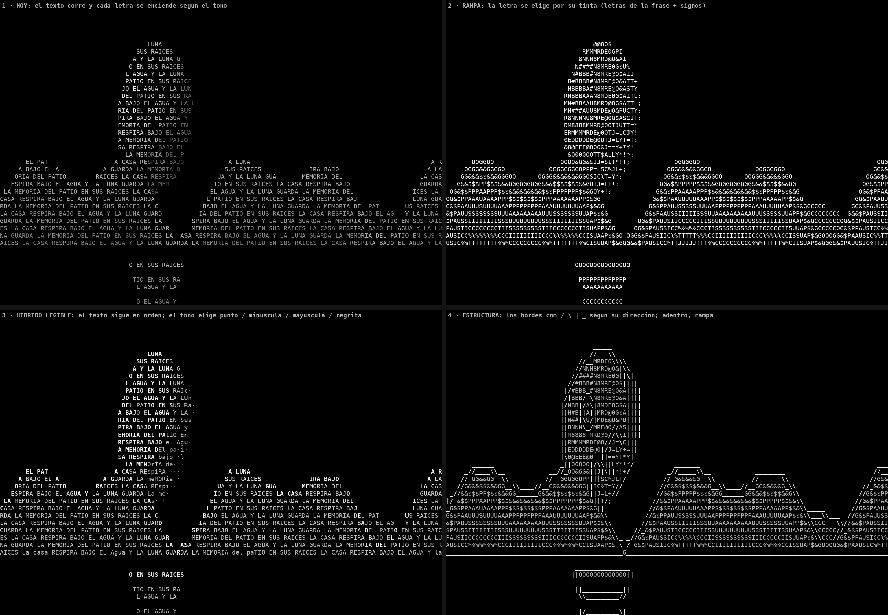

# Revisión del sistema · noviembre de 2026

Rama `charlas-flat` · 13 500 líneas (server.py 3 389 · typeField.js 2 892 · configPanel.js 1 222 · main.js 1 054 ·
show.js 771). Segunda revisión; la primera es [`REVISION-2026-10.md`](REVISION-2026-10.md).

Cómo se hizo: se volvió a comprobar en el código cada error grave de octubre, se midió el costo del motor en 1920 × 690
y en 8400 × 690, se leyó entera la cadena que convierte una oración en imagen, y se armó una maqueta que compara
cuatro maneras de dibujar con letras. Cada hallazgo lleva `archivo:línea`. Lo que no se pudo comprobar está dicho.

## 1. Veredicto

**La aplicación hace más cosas y las hace mejor que hace un mes**: tres paredes, título sólido, cronograma, grabación
configurable, salida por OBS, ajustes de la tecla 0 y de brillo. Las decisiones de base siguen siendo buenas.

**Pero la deuda de octubre casi no se pagó, y creció.** De los seis errores graves de la revisión anterior, uno está
arreglado, uno a medias y cuatro siguen abiertos; tres de esos cuatro son cambios de una a tres líneas. En el mismo
período entraron 14 commits de funciones nuevas, sin una sola prueba automática en el repositorio. El motor pasó de 80
a 99 métodos en una clase, el panel C de 12 a 19 secciones, los lanzadores de 10 a 18.

**El riesgo principal ya no es que falte algo, sino que lo que hay se rompa en la sala sin que nadie lo vea.** Tres
puntos concentran ese riesgo: no hay pruebas versionadas, el operador no tiene avisos visibles, y el formato de 8400 px
cuesta cinco veces más por cuadro que el de 1920.

**Sobre el ASCII:** es viable y la mayor parte de las piezas ya está en el código. Hoy la imagen se dibuja sólo con
brillo; elegir además *qué letra* va en cada celda le daría volumen y contorno. El detalle está en el §4.

## 2. Qué pasó con los errores de octubre

| # | Error (octubre) | Estado hoy | Dónde |
|---|---|---|---|
| 1 | Cambiar un paso del loop a «logos» en el panel C borra el loop entero | **Abierto** | `src/main.js:413`, `src/configPanel.js:1218` |
| 2 | Los 3 s de gracia de la placa no llegan al backend (el constructor de `Show` no guarda `onPrerollReset`) | **Abierto** | `src/show.js:107` y `:662`, `src/main.js:531` |
| 3 | Ningún aviso del show se ve (`notify` descarta el texto) | **Abierto** | `src/main.js:495-497` |
| 4 | Un error al escribir el WAV tumba el servidor | **Arreglado** (la grabación se apaga y avisa) | `server.py:2897` |
| 5 | Se graba audio desde que arranca el programa | **A medias**: ahora se puede apagar y elegir carpeta, pero de fábrica sigue grabando todo | panel C → Grabación |
| 6 | El motor «roba» letras de palabras vivas cuando no hay libres | **Abierto** (sin número de generación) | `src/typeField.js:410` |
| — | Windows abre Chrome a los 4 s sin comprobar que el backend responda | **Abierto** | `start_instalacion.bat:53` |
| — | El WebSocket local no valida `Origin` | **Abierto**, y ahora más serio (ver §3.5) | `server.py` |
| — | Recarga por pérdida de GPU sin tope de intentos | **Abierto** (sí se arregló que la re-proyección la repita) | `src/main.js:996-1004` |
| — | Una tarea que falla termina el servidor entero | **Abierto** (`gather` sin supervisión) | `server.py:2950` |

El error 3 explica varias consultas de estas semanas: «Ningún artista tiene la tecla 6», «No hay artista 3» y «Fin de
la re-proyección» existen en el código pero no aparecen en ningún lado.

**Actualización del 12/11** (después de esta revisión): quedaron arreglados y cubiertos por la prueba de punta a
punta los errores 1, 2 y 3; el 6 se resolvió sin número de generación (el motor busca primero una letra libre en todo
el pool y, si no hay, toma una del telón avisándole a su celda); se valida `Origin` en el WebSocket; los lanzadores
esperan a que respondan los puertos; la recarga por pérdida de GPU tiene tope; una tarea que falla se reinicia sin
tumbar el servidor; el arnés de pruebas está en `tests/`. Además, el modelo devuelve la imagen en ASCII con tonos y el
telón la dibuja eligiendo la letra (§4), y el atlas pasó de 441 a 625 lugares.

## 3. Puntos débiles nuevos o agravados

### 3.1 No hay pruebas en el repositorio

Todo lo que se verificó estas semanas se hizo con un arnés que vive en una carpeta temporal: un OpenAI simulado, un
micrófono simulado y 59 guiones de navegador. Si esa carpeta se pierde, se pierde la única manera de comprobar un
cambio de punta a punta. Además sus servicios se caen seguido y hay que reiniciarlos a mano.

### 3.2 El formato de 8400 px es caro

Medición propia del tiempo de JavaScript de `update()` por cuadro (máquina de prueba lenta y pocas muestras; vale la
comparación, no el número absoluto):

| Formato | Letras reservadas | Escena | Mediana | Percentil 95 |
|---|---|---|---|---|
| 1920 × 690 | 20 278 | loop | 1,4 ms | 12 ms |
| 8400 × 690 | 88 717 | loop | 7,7 ms | 30 ms |
| 8400 × 690 | 88 717 | placa (tecla 2) | 5,4 ms | 16 ms |

Con una cantidad parecida de letras a la vista, el formato ancho cuesta **5,5 veces más**: el costo lo da recorrer
todas las letras reservadas, no las que se ven. A 60 cuadros hay 16,6 ms por cuadro para todo. Encima de eso, en la
sala la misma placa de video mueve Chrome, OBS y Resolume a 8400 × 690, y desde la semana pasada el atlas de letras
ocupa cuatro veces más memoria de video. Nada de esto se midió en la máquina real.

### 3.3 El operador trabaja a ciegas

- Los avisos no se ven (error 3). El único canal es el título de la ventana, invisible en pantalla completa y dentro
  de OBS.
- Con OBS, el show se opera desde la ventana «Interactuar», que es incómoda y se cierra fácil. Si además se abre el
  show en Chrome, son dos shows distintos.
- El panel C tiene 19 secciones al mismo nivel: lo de la noche (artistas, micrófono, cronograma) está mezclado con
  calibración (tratamientos, prompts, órbita).
- No hay guía de operador de una carilla. El README tiene 690 líneas.

### 3.4 Dependencias externas sin respaldo

- **Transcripción:** depende sólo de OpenAI Realtime. No hay reconocimiento de voz local. Sin internet, la tecla 0
  queda en negro.
- **Cronograma:** lee una planilla de Google con la dirección fija en el código (`server.py:2537`), no
  flatfestival.org. La planilla está compartida como «cualquiera con el enlace puede editar». Si cambia la pestaña o
  los títulos de las columnas, la propuesta de placas deja de actualizarse y queda la última copia.
- **Emoji como fuente de imagen:** la silueta sale de la tipografía de emoji del sistema, distinta en Windows y en Mac.
- **OBS y Resolume:** el perfil y la escena de `obs/` se escribieron a mano y nunca se importaron en un OBS real.

### 3.5 Seguridad del WebSocket local

El servidor acepta conexiones de cualquier página abierta en el mismo equipo (no mira `Origin`). Desde octubre el
protocolo ganó mensajes con más alcance: `set_rec` hace que el servidor cree carpetas y escriba el WAV en la ruta que
le manden (`server.py:2764-2768`), además de guardar la clave de OpenAI y cambiar ajustes. En una máquina dedicada al
show el riesgo es bajo; si en esa máquina se navega, deja de serlo.

### 3.6 Estructura

- **Ajustes:** 21 marcas de migración (`*_vN`) repartidas entre `main.js` y `show.js`, y una lista blanca manual en el
  backend (`SettingsStore.KEYS`). Un ajuste que falte en esa lista se descarta sin aviso; ya pasó con `formato_v10`.
- **Atlas de letras al límite:** tiene 441 lugares. Con las cuatro familias en uso (105 caracteres cada una) más los
  21 signos ASCII da exactamente 441. Un carácter fuera de la lista, o una familia más, cae en un punto «·»
  (`src/glyphAtlas.js:66`). Es una cuenta, no una falla observada.
- **Lanzadores:** 18 archivos que multiplican formato × plataforma × modo. Cada formato nuevo agrega cuatro.
- **Estado de escena:** sigue escribiéndose desde cinco lugares; cada escena nueva es una ocasión de olvidar una
  bandera.

### 3.7 Lo agregado estas semanas que no se vio andar de verdad

- El desarme del título sólido en letras: se comprobó congelado, no a velocidad real.
- La salida por OBS a 8400 px: el navegador de prueba no puede crear un lienzo de ese ancho; se probó a la mitad.
- El botón de acreditaciones: se comprobó que pide abrir la dirección correcta, no que el navegador la muestre.

## 4. Generación de imágenes con ASCII

### 4.1 Qué hace hoy el programa

La cadena completa (`src/main.js:154-197`, `src/treatments.js`):

1. **Fuente.** Por cada oración, el director (un modelo de lenguaje) devuelve una de estas cosas: una composición de
   12 a 40 formas con tono, una grilla de 48 × 26 de `#` y `.`, trazados SVG, un emoji, o arte ASCII hecho con las
   letras dichas. Si todo falla, una figura de la biblioteca.
2. **Tonos.** Cualquiera de esas fuentes se pasa a una grilla de tonos de 0 a 1 con la resolución del telón: 40 filas
   por hasta 120 columnas, celdas el doble de altas que anchas.
3. **Tratamiento.** Topografía, trama, erosión, eco o silueta convierten los tonos en dibujo.
4. **Telón.** Cada celda del telón es una letra del texto dicho. El tono decide **cuánto se enciende**
   (`src/typeField.js:1496-1499`); la letra es la que le toca por orden de lectura.

Es decir: **hoy la imagen se hace sólo con brillo.** La letra de cada celda no depende de la imagen.

Ya existen, sin usarse en este camino:

- La tinta de cada letra medida al dibujarla (`atlas.ink`, `src/glyphAtlas.js:42`), que es justo lo que necesita una
  rampa ASCII.
- Un armador de ASCII clásico por rampa de tinta (`_asciiTargets`, `src/typeField.js:807`), pero sólo en el modo
  «caligrama», que no es el de fábrica.
- Un formato del director que pide ASCII con rampa de densidad (`server.py:1610`), pero el programa lo reduce a
  blanco y negro: los tonos intermedios se tiran (`rowsToTone`, `src/treatments.js:175`).
- La distancia al borde de la figura (`signedDistance`, `src/treatments.js:189`), que sirve para saber dónde hay contorno.

### 4.2 Cuatro maneras de dibujar la misma imagen

Maqueta hecha fuera del programa (`img/ascii_comparacion.py`), con una imagen de prueba sintética, la misma grilla
de 120 × 40 y otra tipografía. Sirve para comparar técnicas, no para juzgar el aspecto final.

| | Técnica | Qué gana | Qué pierde |
|---|---|---|---|
| 1 | **Hoy:** el texto corre y cada letra se enciende según el tono | Se leen las palabras dichas | La imagen es una silueta con sombreado suave; poco volumen |
| 2 | **Rampa:** la letra se elige por su tinta, usando las letras de la frase y signos | Volumen y luz claros: es el ASCII clásico | Las palabras dejan de leerse |
| 3 | **Híbrido legible:** el texto sigue en orden; el tono elige punto, minúscula, mayúscula o negrita | Se leen las palabras **y** hay volumen | Necesita una familia más en el atlas, que está lleno (§3.6) |
| 4 | **Estructura:** los bordes con `/ \ | _` según su dirección; adentro, rampa | Contornos nítidos, aspecto de dibujo técnico | Se ve bien sólo con imágenes de bordes limpios |

### 4.3 El límite real no es el dibujo, es la fuente

Con 40 filas, cualquier técnica alcanza para una figura reconocible. Lo que limita hoy la calidad es **de dónde sale
la imagen**:

- Un modelo de lenguaje dibuja mal. Con formas geométricas da composiciones abstractas; con grillas de 48 × 26 da
  siluetas toscas y a veces inválidas (por eso existen la verificación y el reintento).
- Pedirle ASCII directo al modelo es lo menos confiable de todo. No conviene invertir más ahí.

Fuentes mejores, de menor a mayor costo:

| Fuente | Qué da | Demora | Costo | Reparos |
|---|---|---|---|---|
| **Tipografía de emoji empaquetada** (Noto Emoji, licencia libre) | La misma silueta en Windows y Mac | Ninguna | Nulo | Sigue siendo una silueta plana |
| **Banco de imágenes preparado** por charla, a partir del cronograma y la curaduría; en vivo se elige por palabras clave | Imágenes con volumen, revisadas antes | Ninguna | Se paga una vez, antes | Hay que prepararlo para cada fecha |
| **Cámara en vivo** convertida a letras: la figura del disertante hecha con sus propias palabras | La imagen más fuerte, sin IA | Ninguna | Nulo | Consentimiento de quien habla; hoy el tono se calcula una vez por imagen (`src/typeField.js:1493`) y habría que hacerlo por cuadro |
| **Modelo de imágenes en vivo**, una imagen por oración | Imágenes con volumen, a medida | Varios segundos por imagen | Un costo por imagen que, a una cada 14 s, suma unas 250 por hora | La demora desfasa la imagen de lo dicho; precio y tiempos a medir antes de decidir |

### 4.4 Recomendación

1. **Primero el dibujo (pocos días):** llevar al telón las técnicas 2, 3 y 4 como una opción más del panel C, junto a
   los tratamientos. De fábrica, la 3: mantiene la idea de la obra (la imagen está hecha con lo que se dice) y agrega
   volumen. Requiere agrandar el atlas.
2. **Después la fuente (una a dos semanas):** tipografía de emoji empaquetada y banco de imágenes por charla. Dejar de
   tirar los tonos intermedios de la grilla de densidad.
3. **Cámara en vivo:** probarla como una animación más (por ejemplo en una tecla libre), con el tono actualizado por
   cuadro.
4. **Modelo de imágenes en vivo:** sólo como experimento, midiendo demora y costo reales en una prueba de sala.

Riesgos a mirar en la prueba: legibilidad a la distancia de la sala (la imagen ocupa la pared de frente, 1775 px, unas
17 px por fila) y que el brillo extra de la negrita no tape las palabras sueltas.

## 5. Propuesta de mejora

### Etapa 0 · Antes de la próxima función (1 a 2 días)

1. Arreglar los errores 1, 2 y 3 del §2. Son una a tres líneas cada uno.
2. Validar `Origin` en el WebSocket y limitar `set_rec` a carpetas del usuario.
3. Windows: esperar a que respondan los puertos 5173 y 8765 antes de abrir Chrome u OBS.
4. **Meter el arnés de pruebas al repositorio** (`tests/e2e/`) con un solo comando que recorra la noche: loop, título,
   placas 1 a 7, tecla 0, cierre, grabación y re-proyección.
5. Probar en la máquina de la sala la cadena OBS + Resolume y medir cuadros por segundo en 8400 × 690.

### Etapa 1 · Que el operador vea y controle (1 semana)

6. **Control remoto.** Una ventana común de Chrome con el panel C que maneje el show que corre dentro de OBS. El
   protocolo ya lo permite: la re-proyección hace exactamente eso con `replay_ui` (`server.py:3134`,
   `src/main.js`). Falta que el servidor reenvíe las teclas de un cliente «control» al cliente «pantalla».
7. **Franja de estado** en esa ventana de control: micrófono, transcripción, grabación, calidad, cuadros por segundo y
   los avisos que hoy se pierden.
8. **Panel C en dos niveles:** «Esta noche» (cronograma, artistas, micrófono, tecla 0, brillo) y «Calibración»
   plegado.
9. **Guía de operador de una carilla** y un solo lanzador por plataforma que pregunte formato y modo, en lugar de 18.

### Etapa 2 · ASCII (1 a 2 semanas)

10. Los puntos 1 y 2 del §4.4: técnicas de dibujo en el telón, atlas más grande, tipografía de emoji empaquetada,
    banco de imágenes por charla.
11. Prueba de la cámara en vivo como animación.

### Etapa 3 · Consolidación (2 a 3 semanas)

12. Un solo módulo de ajustes con versión numérica, todas las migraciones juntas y un esquema compartido con el
    backend, en lugar de la lista blanca manual.
13. `field.applyScene(preset)`: una tabla con todas las banderas de cada escena.
14. Ciclo de vida de las letras (reserva, liberación, número de generación) y listas por estado. Arregla el error 6 y
    es el requisito para bajar el costo en 8400 px. Objetivo medible: `update()` por debajo de 3 ms en el loop.
15. Supervisión de tareas en el servidor: que una que falla se reinicie sola y avise, sin tumbar el resto.

### Etapa 4 · Respaldo y distribución (cuando el calendario lo permita)

16. Reconocimiento de voz local como respaldo cuando OpenAI no responde.
17. Cronograma: dirección configurable desde el panel, aviso si la planilla cambió de forma, y planilla en «sólo
    lectura» para quien no sea del equipo.
18. Versión empaquetada que arranque sin internet, con una prueba de humo que el diagnóstico pueda correr.

## 6. Qué no cambiaría

El telón como fondo que se cala; la imagen hecha con lo dicho; grabar audio y eventos por separado; la re-proyección
con el mismo programa; el protocolo simple entre servidor y pantalla; los tratamientos deterministas por semilla, que
hacen que la re-proyección repita la misma imagen. El ASCII propuesto se apoya en todo eso, no lo reemplaza.
